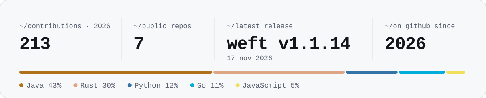

<picture>
  <source media="(prefers-color-scheme: dark)" srcset="assets/banner-dark.svg">
  
</picture>

 

I build small, sharp tools — mostly for myself and my friends: networking, Minecraft mods and servers, terminal toys.

 

<picture>
  <source media="(prefers-color-scheme: dark)" srcset="assets/card-dark.svg">
  
</picture>

  

<table>
  <tr>
    <td width="50%" valign="top">
      <b><a href="https://github.com/qateralong/weft">weft</a></b> &nbsp;<code>rust</code>
       Peer-to-peer virtual LAN for Linux, Windows and macOS. Noise encryption, own coordination server.
    </td>
    <td width="50%" valign="top">
      <b><a href="https://github.com/qateralong/termcade">termcade</a></b> &nbsp;<code>go</code>
       A tiny multiplayer arcade you play over SSH. Nothing to install.
    </td>
  </tr>
  <tr>
    <td width="50%" valign="top">
      <b><a href="https://github.com/qateralong/tactical_loadout">tactical loadout</a></b> &nbsp;<code>java</code> <code>neoforge</code>
       Minecraft mod: body armor with per-zone protection, working camo, night vision and CS2 grenades.
    </td>
    <td width="50%" valign="top">
      <b><a href="https://github.com/qateralong/server-ai-agent">server-ai-agent</a></b> &nbsp;<code>java</code>
       Personal AI agent for Linux: JavaFX + Telegram, Ollama or Claude, voice, scripts and memory.
    </td>
  </tr>
</table>

 

<picture>
  <source media="(prefers-color-scheme: dark)" srcset="https://skillicons.dev/icons?i=rust%2Cjava%2Cgo%2Cpython%2Clinux%2Carch%2Cbash%2Cgit%2Cgradle&theme=dark">
  
</picture>
